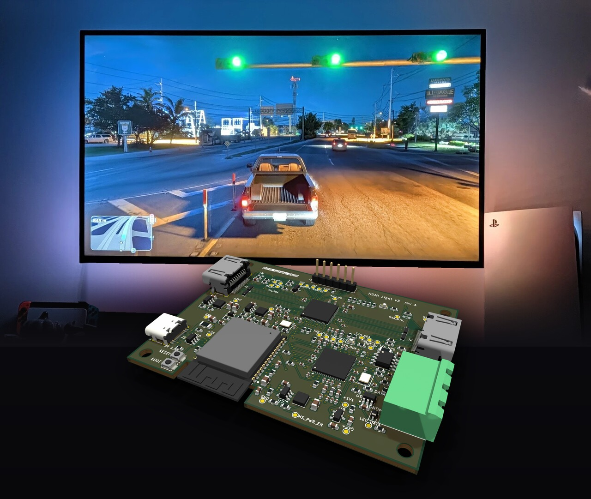
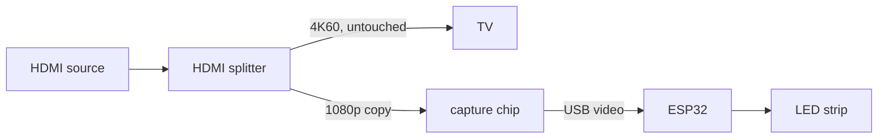

# HDMI Light v3

Ambilight for a 4K TV, with no PC and no plugin in your media player. One small board sits between your HDMI
source and the TV, watches the picture going past, and drives an LED strip behind the screen so the wall glows
the colours at the edges of the image — in real time, whatever the source is.



## How it works



- An **HDMI splitter** (GSV2001) sends the picture straight on to the TV — 4K60 with HDR, nothing re-encoded or
  delayed — and makes a second, smaller copy. It answers the source's HDCP 2.2, so streaming boxes are happy.
- A **capture chip** (MS2130) turns that copy into a USB video stream, the way a cheap capture stick does.
- An **ESP32-S31** decodes it 30 times a second and drives the strip. `core/` is
  [HyperHDR](https://github.com/awawa-dev/HyperHDR)'s colour pipeline recompiled for a microcontroller — the same
  HDR tone mapping, black-bar detection and smoothing, rewritten in portable C (MIT, `core/LICENSE.HyperHDR`).

All three sit on one 78 × 60 mm board. You set it up from a web page it serves, and it appears in Home Assistant
as a light. The LEDs never depend on your network: unplug the router and they keep following the picture.

## Getting one going

You need the board, a 5 V 1.5 A USB-C supply, two HDMI cables, and a WS2812, WS2815, WS2811 or SK6812 RGBW strip
on its own 5 V supply with the grounds joined and data into J4. (94 LEDs at full white draw about 5.6 A, so
brightness is capped at 60 % by default.)

**Order the board** at [JLCPCB](https://jlcpcb.com): zip up `hardware/fab/gerbers/` and upload it — 4 layers,
1.6 mm, stackup JLC04161H-7628, impedance control, top-side assembly — with `fab/bom_jlcpcb.csv` and
`fab/cpl_jlcpcb.csv`, and check the rotations in their placement preview. Four parts come back unfitted and go on
by hand: the splitter U2 (QFN-76, hot air), the ESP32 module U1, and the headers J4 and J5.

**Flash it** with [ESP-IDF](https://docs.espressif.com/projects/esp-idf/) 6.1 or newer:

```bash
cd firmware && ./idf-oneboard.sh set-target esp32s31 && ./idf-oneboard.sh build
```

```bash
./idf-oneboard.sh -p /dev/cu.usbmodem* flash monitor
```

The capture chip's own flash arrives blank and is written once over the same cable with
`tools/ms2130_serial.py write <image>`. Later updates go over Wi-Fi (`tools/ota_paced.py`), into one of two app
slots, and roll back on their own if the new image cannot reach the network.

**Set it up**: the board puts up its own Wi-Fi network, `hdmilight-xxxx`, password `hdmilight`, with a page at
`http://192.168.4.1`. Pick your network and a name and it answers at `http://<name>.local/` from then on — live
view, strip layout, brightness, colour, HDR, logs, self-test and updates, all also under `/api/`. There is no
password on that page, so keep the board on a network you trust.

The LEDs fade out shortly after the TV goes to standby and come back when it wakes (the page has TV on/off
buttons over CEC), and two seconds after the picture stops.

## What is in here

| Folder | |
|---|---|
| `firmware/` | the ESP-IDF project; `main/www/index.html` is the whole web UI |
| `core/` | the colour pipeline — portable C, no ESP-IDF, tested on the host |
| `hardware/` | the board: a KiCad project generated by the scripts in `gen/`, order files in `fab/` |
| `gsv2001/` | the HDMI splitter driver, its tests, and the tools that check it against the real thing |
| `ms2130/` | tools for the capture chip's flash image |
| `tools/` | updating, flashing, crash decoding and host tests |

Everything is testable without hardware; `make -C core test` and `make -C gsv2001 check` matter most.

---

The board — netlist, hand-scripted routing, fabrication files — and its firmware were made with Claude Fable 5.2,
which also brought the first one up with Colin at the bench.
